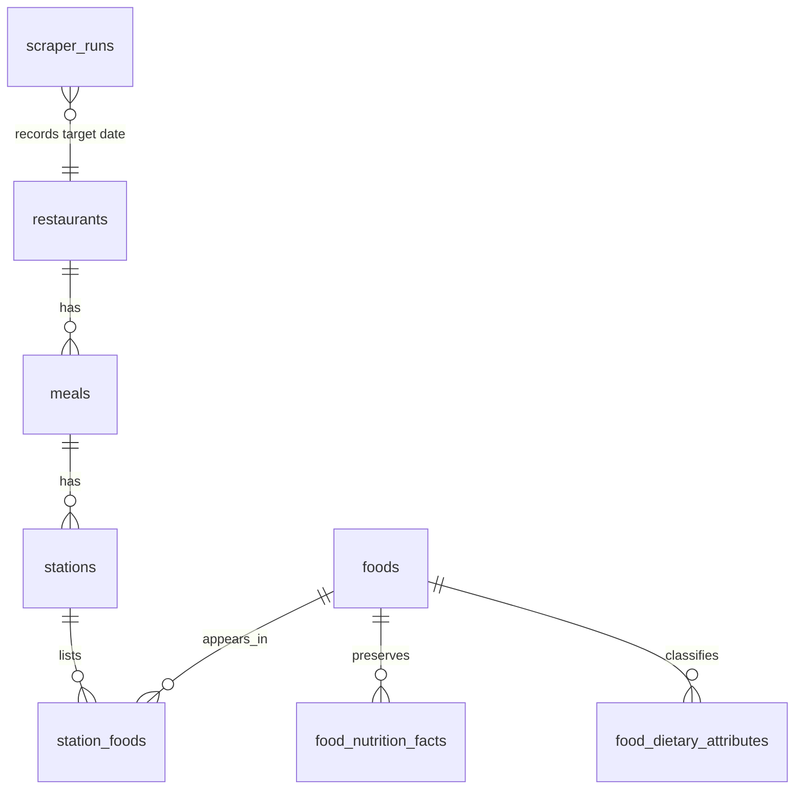

# SQL Walkthrough

This project is intentionally relational: the frontend planner is useful, but the portfolio value is the normalized menu model, SQL-backed API, import audit trail, and least-privilege deployment.

## Schema Shape

The core model separates content-addressed nutrition variants from where each variant appears on a specific service date:



Why this matters:

- `(foods.external_id, foods.content_hash)` is unique. The encoded recipe ID remains a source identifier while the hash prevents a context-specific nutrition or allergen variant from overwriting another one.
- `food_nutrition_facts` preserves the complete ordered source facts, units, percentage daily values, and secondary-row flags; `food_dietary_attributes` preserves extensible source tags.
- `station_foods` handles many-to-many appearances: one exact food variant can appear at multiple stations or meals.
- `scraper_runs` records operational metadata separately from menu facts, which keeps API freshness auditable.
- Date-scoped tables and indexes let the API answer "what is available today?" without dynamic SQL.

## Run Queries Locally

After `docker compose up`, run an internal MySQL shell with the same read-only account used by the API:

```bash
docker compose exec -T mysql sh -c 'MYSQL_PWD="$MYSQL_API_PASSWORD" mysql -u"$MYSQL_API_USER" "$MYSQL_DATABASE"'
```

The queries below use `2026-07-01`, which is present in the bundled seed data and may be refreshed by live scraper imports.

## Menu Hierarchy Join

This query powers the dashboard's restaurant -> meal -> station -> food hierarchy:

```sql
SELECT
  r.name AS restaurant,
  m.name AS meal,
  s.name AS station,
  f.short_name AS food,
  f.calories,
  f.protein
FROM restaurants r
JOIN meals m ON m.restaurant_id = r.id
JOIN stations s ON s.meal_id = m.id
JOIN station_foods sf ON sf.station_id = s.id
JOIN foods f ON f.id = sf.food_id
WHERE r.service_date = '2026-07-01'
ORDER BY r.name, m.time_open, s.name, f.short_name
LIMIT 10;
```

Review point: this is a five-table join with deterministic ordering and no request-controlled table, column, or sort names.

## Coverage Metrics

This aggregate backs `/api/metrics/coverage`, a public diagnostic/portfolio endpoint:

```sql
SELECT
  DATE_FORMAT(r.service_date, '%Y-%m-%d') AS service_date,
  COUNT(DISTINCT r.id) AS restaurants,
  COUNT(DISTINCT m.id) AS meals,
  COUNT(DISTINCT s.id) AS stations,
  COUNT(DISTINCT f.external_id) AS foods,
  COUNT(DISTINCT f.id) AS food_variants,
  COUNT(sf.food_id) AS menu_item_placements,
  COUNT(DISTINCT CASE WHEN f.vegan THEN f.id END) AS vegan_items,
  COUNT(DISTINCT CASE WHEN f.vegetarian THEN f.id END) AS vegetarian_items,
  COUNT(DISTINCT CASE WHEN f.gluten_free THEN f.id END) AS gluten_free_items
FROM restaurants r
LEFT JOIN meals m ON m.restaurant_id = r.id
LEFT JOIN stations s ON s.meal_id = m.id
LEFT JOIN station_foods sf ON sf.station_id = s.id
LEFT JOIN foods f ON f.id = sf.food_id
WHERE r.service_date = '2026-07-01'
GROUP BY r.service_date;
```

Review point: the three counts answer different questions. `foods` is the number of source recipe IDs, `food_variants` is the number of distinct nutrition/content records, and `menu_item_placements` is the number of station occurrences.

## Nutrition Ranking

This query uses the same normalized model for a simple nutrition ranking:

```sql
SELECT
  f.short_name,
  f.calories,
  f.protein,
  GROUP_CONCAT(DISTINCT s.name ORDER BY s.name SEPARATOR ', ') AS stations
FROM restaurants r
JOIN meals m ON m.restaurant_id = r.id
JOIN stations s ON s.meal_id = m.id
JOIN station_foods sf ON sf.station_id = s.id
JOIN foods f ON f.id = sf.food_id
WHERE r.service_date = '2026-07-01'
GROUP BY f.id
ORDER BY f.protein DESC, f.calories ASC
LIMIT 5;
```

Review point: this is the same data shape a user needs for meal planning, but expressed as a SQL-backed ranking problem.

## Station Nutrition Comparison

This aggregate backs `/api/metrics/stations` and supplies station-level context to the planner and analytical API consumers:

```sql
SELECT
  r.name AS restaurant,
  m.name AS meal,
  s.name AS station,
  COUNT(DISTINCT f.id) AS food_count,
  ROUND(AVG(f.calories), 1) AS avg_calories,
  ROUND(AVG(f.protein), 1) AS avg_protein,
  COUNT(DISTINCT CASE WHEN f.vegan THEN f.id END) AS vegan_items,
  COUNT(DISTINCT CASE WHEN f.gluten_free THEN f.id END) AS gluten_free_items
FROM restaurants r
JOIN meals m ON m.restaurant_id = r.id
JOIN stations s ON s.meal_id = m.id
JOIN station_foods sf ON sf.station_id = s.id
JOIN foods f ON f.id = sf.food_id
WHERE r.service_date = '2026-07-01'
GROUP BY r.service_date, r.id, m.id, s.id
ORDER BY avg_protein DESC, food_count DESC, restaurant, meal, station
LIMIT 12;
```

Review point: this turns the normalized many-to-many model into a station-level decision aid without exposing arbitrary grouping, ordering, or SQL controls to public users.

## Import Freshness And Audit Trail

The scraper and scheduler write every successful import, and scheduled failures are recorded as `failed` rows:

```sql
SELECT
  DATE_FORMAT(target_date, '%Y-%m-%d') AS target_date,
  status,
  restaurants_count,
  meals_count,
  foods_count,
  distinct_recipes_count,
  food_variants_count,
  menu_item_placements_count,
  started_at,
  finished_at,
  error_message
FROM scraper_runs
WHERE target_date = '2026-07-01'
ORDER BY started_at DESC
LIMIT 5;
```

Review point: data freshness is not implied by logs alone; the database can answer when a date was last imported and whether the most recent import failed. `foods_count` remains the legacy import-volume count of appearances. The three explicit columns distinguish source recipe IDs, content variants, and station-menu placements.

## Safety Choices

- API queries use `mysql2/promise` placeholders and Zod validation.
- Search text is allowlisted, ranked with a food `FULLTEXT` index, and escaped for `LIKE` fallback/context matching.
- Allergen filters map request values to a fixed server-side column allowlist.
- The public backend connects as `MYSQL_API_USER`, which has `SELECT`/`SHOW VIEW` only.
- The scraper and scheduler use `MYSQL_SCRAPER_USER`, which has the write grants needed for imports but is not reachable from public routes.
