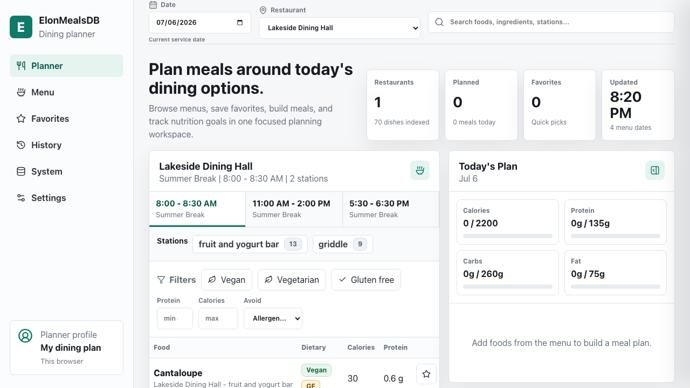
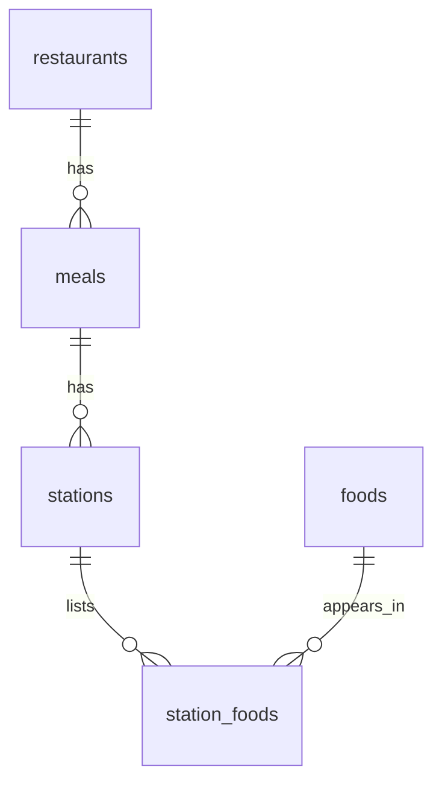

Elon's dining website has a surprising amount of useful information. It shows which restaurants are open, what each station is serving, ingredients, allergens, and full nutrition facts. The problem I had as a student was that none of it was easy to use.

Seeing what was available at a glance meant opening menus one at a time. There was no practical way to search every dining hall for a specific food. The nutrition data was detailed, but buried behind individual items. I also wanted to add foods to a meal and see the total calories without doing the math myself.

I started [ElonMealsDB](https://github.com/ChaddBrenner/ElonMealsDB) while I was at Elon to fix those problems. I built the backend, the web scraper, and a simple interface during undergrad. The original version worked, but it was rough and never became the tool I had pictured. I recently came back to it, kept the original idea, and rebuilt it into something I would have actually used as a student.

I also wanted an excuse to do more with SQL, and this was a problem where a relational database actually made sense. I was not adding one to an app that could have been a flat file.

The [live version](https://elonmealsdb.chadd.blog/) is independent from Elon University and Elon Dining. Menu, nutrition, and allergen information should still be confirmed with the official dining provider when it matters.



## Starting With the Menu Data

The first job is turning the dining website into data I can query. The Python scraper starts with Elon's menu and hours page, finds the restaurants and meal times for a date, and then visits each restaurant page. Those pages contain stations, food names, dietary labels, and embedded nutrition data.

The scraper converts that page structure into restaurants, meals, stations, and foods. It also pulls calories, protein, carbohydrates, fat, ingredients, serving sizes, dietary labels, and allergen flags when they are available.

Scraping current data also means bad responses are part of the job. Some dates have fewer restaurants open, some nutrition fields are missing, and the source page can change or fail. The more dangerous case is a structurally incomplete response that looks superficially successful. If I accepted that as a complete import, it could replace a valid menu with missing restaurants, meals, or foods.

The importer now validates the requested date, source structure, status-specific expectations, and independently recomputed counts before it writes anything. A structured meal marked available must contain food, while legitimate external links, PDFs, hours-only resources, and unpublished menus can remain foodless with an explicit status. A private scheduler tries failed imports again later. The `scraper_runs` table keeps the target date, source, timestamps, recipe/variant/placement counts, status, and error message, so I can tell whether the data is current without relying only on container logs.

## Putting the Menu Into MySQL

Once I broke the menu down, the database structure was pretty straightforward:



A restaurant can serve several meals in a day. Each meal has stations, and each station lists foods. The same exact food variant can appear at more than one station or meal, so `station_foods` acts as the junction table instead of duplicating that content-addressed nutrition record each time. When Elon reuses a recipe ID with different nutrition or allergens, the content hash creates a separate variant rather than overwriting the earlier record.

The `foods` table uses the source recipe ID together with a deterministic content hash as its unique key. When the scraper sees the same exact variant again, it reuses that record and creates the needed station relationship. If nutrition, ingredients, dietary data, or allergens differ for the same recipe ID, the importer stores a separate variant instead of overwriting prior source data.

With the data split up this way, I can answer the questions I actually care about:

* What is being served on a specific date?
* Where can I find a particular food?
* Which options match a dietary or allergen filter?
* Which foods have more protein without adding as many calories?
* How many distinct foods are available, even when some appear in several places?

This is the basic join behind the menu:

```sql
SELECT
  r.name AS restaurant,
  m.name AS meal,
  s.name AS station,
  f.short_name AS food,
  f.calories,
  f.protein
FROM restaurants r
JOIN meals m ON m.restaurant_id = r.id
JOIN stations s ON s.meal_id = m.id
JOIN station_foods sf ON sf.station_id = s.id
JOIN foods f ON f.id = sf.food_id
WHERE r.service_date = :serviceDate
ORDER BY r.name, m.time_open, s.name, f.short_name;
```

From there, I use grouped queries for station comparisons and `COUNT(DISTINCT ...)` when a food should only count once. Food search uses a full text index across names, descriptions, and ingredients, with additional matching for restaurants, meals, and stations. This is where SQL does most of the useful work.

## The Backend

The backend is an Express API using `mysql2/promise`. It can list service dates, build a restaurant's full menu, search foods, and return nutrition and station summaries. I validate request values before they reach the database and pass SQL parameters separately from the query text.

I did not want the public site and the scraper sharing the same database login. The API user can only read. A separate scraper account has the write access needed for imports, and there is no public endpoint that can run the scraper or change menu data.

## Iterating on the Interface

I am very opinionated about interfaces, but I am not a frontend developer and I struggle with designing a page from a blank screen. I am much better at critiquing something I can use. Codex was especially useful for turning my UI ideas into React and CSS, which gave me something concrete to critique and improve. It made that loop much faster, but the direction came from being picky about what felt wrong.

To me, a visually appealing interface is usually the result of an efficient one. The best description I have for what I like is low friction, utilitarian, but not ugly. The layout should make it difficult to get lost, and every element should have a reason to be there. Redundant information is one of my biggest pet peeves. If the same value appears twice on one screen, it is usually competing with itself for attention.

Color follows the same rule. Calories, protein, carbohydrates, and fat each keep a consistent color across the planner and visualizations. Dietary labels, warnings, selected states, and meal windows are also meant to be recognizable without making the page feel crowded.

The calorie and macro summary at the top is one example. It shows the totals for the current meal plan and is prominent when the page first loads. Once the user scrolls, it becomes smaller but stays visible. The information remains available without taking over the screen.

The menu has both an overview and a table because they solve different problems. The overview groups food names by station for a quick scan. The table is better when someone wants calories, protein, dietary labels, or other details. It can be sorted, filtered, and reduced to only the columns the user cares about. On smaller screens, the overview becomes the default.

The nutrition visualizations follow the same approach. A protein scatter plot, macro triangle, dietary heatmap, and ranked tables surface useful patterns without dumping every field onto the page. Their points and food rankings open the underlying nutrition details. I did not want charts that looked interesting but acted like dead images.

I found most of the remaining problems by using the app myself. I searched, built meals, changed quantities, switched dates, resized the page, and tried to move through it quickly. I also borrowed ideas from websites I enjoy using, especially how they organize information and keep common actions close at hand.

I originally experimented with accounts and storing meal history on the server. When I rebuilt the project, I decided they were unnecessary. Favorites, selected foods, nutrition goals, and planning preferences now stay in the browser. Selecting a food opens its full nutrition and ingredients. Adding it to the planner updates the totals, quantities can be adjusted in quarter serving steps, and the plan can be exported as a CSV.

## Keeping It Running

I host the live app myself with Docker Compose using separate frontend, backend, MySQL, and scraper scheduler services. Cloudflare Tunnel provides the public HTTPS connection and Caddy forwards requests to the frontend. The API, database, and importer remain on the private Docker network.

The scheduler imports the current and next day's menus several times a day. Failed attempts are written to the database, and the next scheduled run still happens. This matters because dining menus are not always published at the same time, and a temporary source problem should not stop future updates.

Every push and pull request triggers separate GitHub Actions jobs for the Node application, Python scraper, and Docker stack. The Docker job builds fresh images, starts the full Compose stack on a clean runner, checks the health and API routes, and confirms that the API database user cannot write. I run the same broader checks locally before updating the production stack on my own server.

## What I Learned

The biggest thing this project reinforced for me is that having detailed data is not the same as making it useful. Elon Dining already had the information I wanted. The work was collecting it reliably, giving it a clean structure, and building the searches and summaries that the original pages were missing.

Coming back to an old student project also made it easier to see which complexity was helping. The relational model, audit trail, scheduled imports, and separate database permissions all solve real problems. Server accounts and a larger authentication system did not improve the main experience, so I removed them.

ElonMealsDB is now much closer to the tool I wanted in college. I can open one page, see what is being served, search for a food across the menu, inspect its nutrition, and build a meal while the totals update. The SQL and backend are a large part of the project because the data and the problem actually need them.
